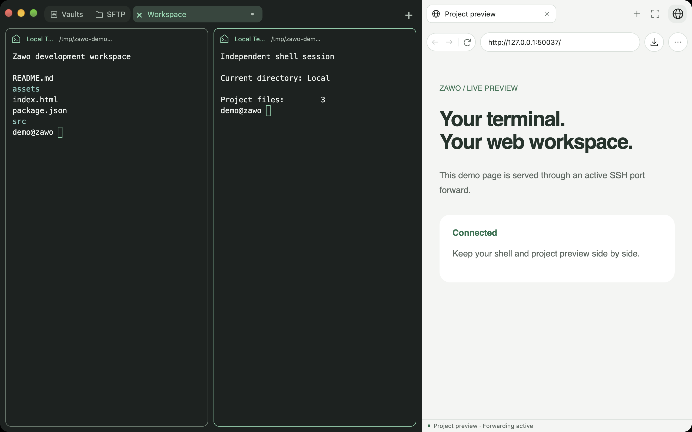
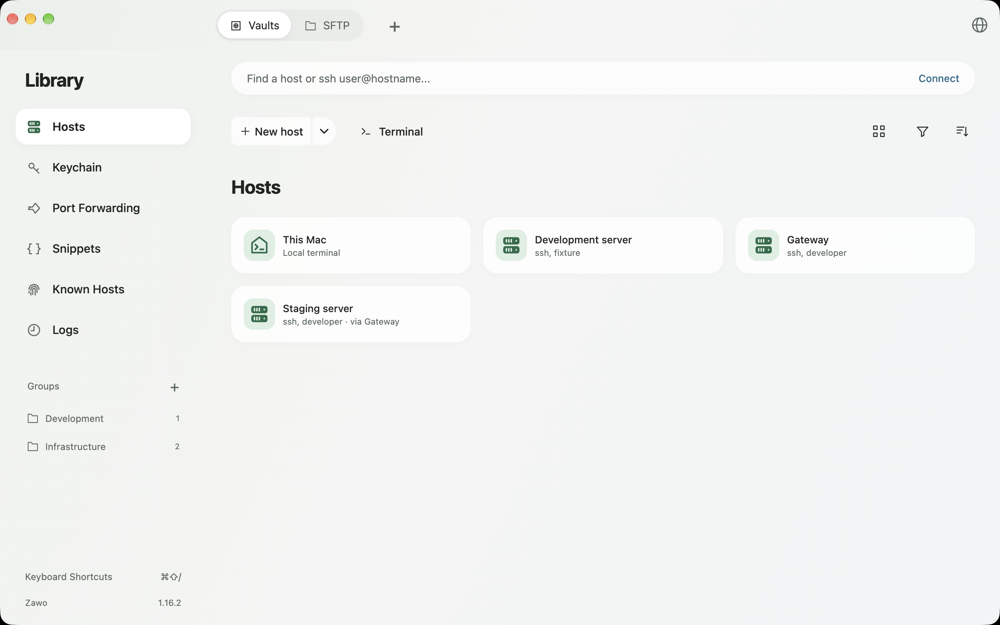
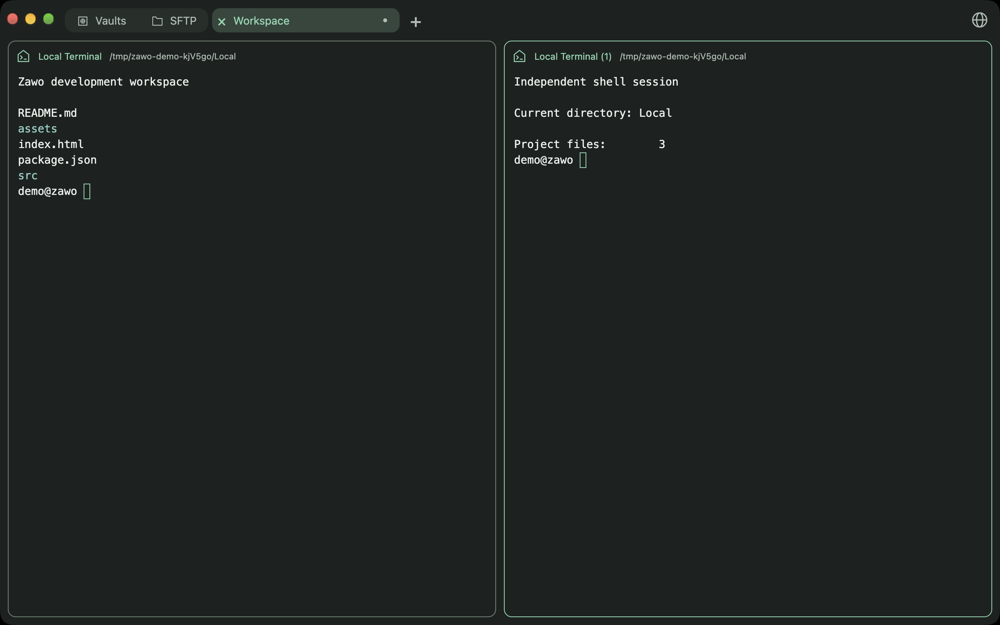
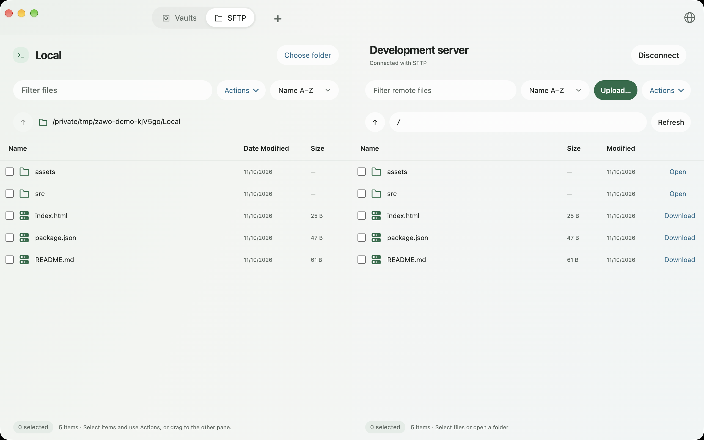
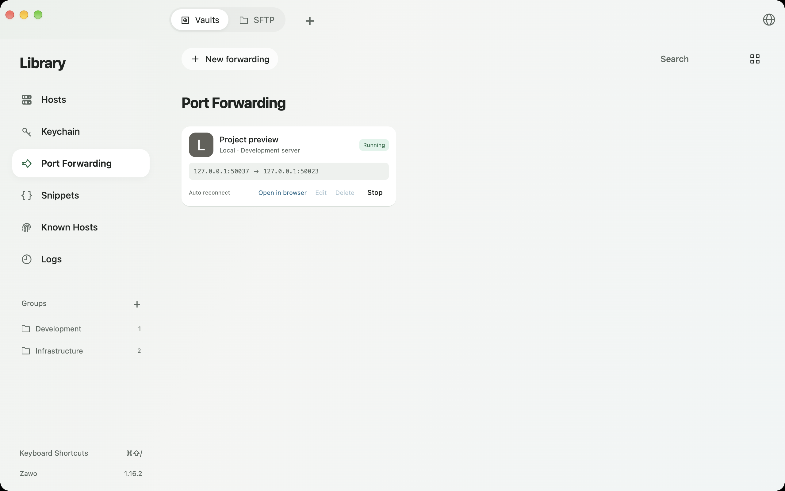
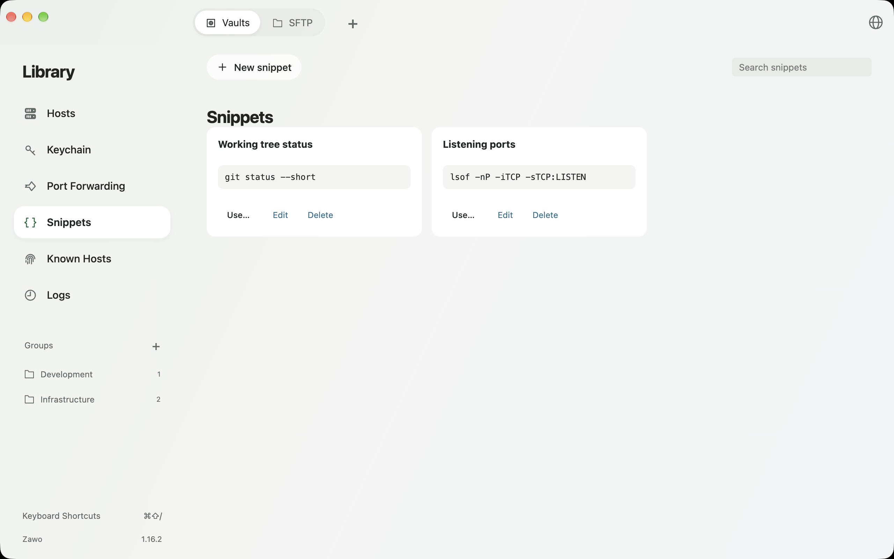

<p align="center">
  
</p>
<h1 align="center">Zawo</h1>
<p align="center">Lokale Terminals, SSH und Webvorschau. Ein Arbeitsbereich für macOS.</p>
<p align="center">
  <a href="https://github.com/mailbobg/zawo/releases/latest"></a>
  
  <a href="LICENSE"></a>
</p>
<p align="center"><a href="README.md">English</a> · <a href="README.zh-CN.md">简体中文</a> · <strong>Deutsch</strong></p>
<p align="center"><a href="https://github.com/mailbobg/zawo/releases/latest">Herunterladen</a> · <a href="CHANGELOG.md">Änderungsprotokoll</a> · <a href="docs/DEVELOPMENT.md">Entwicklung</a> · <a href="https://github.com/mailbobg/zawo/issues">Fehler melden</a></p>

Zawo vereint Hostverwaltung, geteilte Terminals, SFTP-Dateiübertragung, Portweiterleitungen und einen seitlichen Browser in einem Desktopfenster.

Das Projekt begann als Versuch, **mit [Craft Anything](https://github.com/storytold/craft-anything) die zentralen Funktionen und Bedienabläufe von [Termius](https://termius.com/) nachzubauen**. Daraus ist eine eigenständige, lokal nutzbare Anwendung entstanden.



[Funktionen](#features) · [Installation](#installation) · [Screenshots](#screenshots) · [Browser & CLI](#browser-cli) · [Projektursprung](#origins) · [Daten & Grenzen](#data-and-limitations) · [Aus dem Quellcode starten](#development) · [Mitwirken](#contributing) · [Lizenz](#license)

<a id="features"></a>

## Funktionen

| Funktion | Möglichkeiten |
|---|---|
| Lokales Terminal | Über **This Mac** eine lokale Shell öffnen, ohne den SSH-Dienst des Systems zu aktivieren |
| SSH & Sprungserver | Mit Passwort oder privatem Schlüssel verbinden, mehrere Sprungserver verketten, neue Host-Fingerabdrücke bestätigen und geänderte Schlüssel blockieren |
| Terminal-Arbeitsbereiche | Tabs, per Drag-and-drop geteilte Terminals, anpassbare Fensterbereiche, Fokusmodus, Suche, Tastenkürzel-Hinweise und Layoutvorlagen |
| Hostverwaltung | Hosts gruppieren, nach Tags filtern, suchen und sortieren; Änderungen werden automatisch gespeichert |
| SFTP | Lokale und entfernte Dateien nebeneinander durchsuchen, Dateien und Ordner übertragen, Warteschlangen verwalten, Übertragungen abbrechen oder wiederholen und Zugriffsrechte ändern |
| Portweiterleitungen | Lokale und entfernte TCP- sowie dynamische SOCKS5-Weiterleitungen einrichten, automatische Neuverbindung aktivieren und lokale Webweiterleitungen im Browser öffnen |
| Seitlicher Browser | Tabs, Vor / Zurück, Adresssuche, Zoom und Downloads nutzen; bei Bedarf öffnen und beim Schließen die Ressourcen der Webseiten freigeben |
| KI-CLI-Anbindung | Mit `zawo browser open` den Browser öffnen; Regeln für Codex, Claude Code, Gemini CLI und OpenCode konfigurieren |
| Befehle & Zugangsdaten | Befehlsschnipsel speichern, Schlüssel wiederverwenden, bekannte Hosts und Verbindungsprotokolle einsehen sowie die gemeinsame Eingabe für einen Arbeitsbereich gezielt aktivieren |
| Sicherung & Migration | Verschlüsselte Konfigurationssicherungen exportieren und wiederherstellen, Hosts als JSON importieren / exportieren und OpenSSH-Konfigurationen übernehmen |

Unter **Zawo → Settings… (⌘,) → Theme** stehen Kaku Light (cremefarben) und Kaku Dark (violett-schwarz) neben den bisherigen Farbschemata zur Auswahl. Änderungen werden automatisch gespeichert und gelten für bestehende und neue Terminals. Die Farben basieren auf [Kaku](https://github.com/tw93/Kaku); siehe [MIT-Lizenz](docs/KAKU-LICENSE.txt).

<a id="installation"></a>

## Installation

1. Lade `Zawo-<version>-arm64.dmg` unter **[Releases](https://github.com/mailbobg/zawo/releases/latest)** herunter.
2. Öffne die DMG-Datei und ziehe **Zawo** in den Ordner **Applications / Programme**.
3. Starte Zawo. Wähle **This Mac** für ein lokales Terminal oder **New host**, um eine SSH-Verbindung anzulegen.

Die veröffentlichte DMG-Datei für **1.16.2** ist mit Developer ID signiert und von Apple notarisiert. Eine Datei mit der SHA-256-Prüfsumme liegt ebenfalls bei.

Die Installationspakete sind derzeit für **Macs mit Apple Silicon** verfügbar. Beende Zawo vor einem Upgrade; laufende Terminalsitzungen werden dabei beendet. Die Programmoberfläche ist derzeit englischsprachig. Die Sprachlinks oben wechseln die Dokumentation.

<a id="screenshots"></a>

## Screenshots

Die Bilder zeigen **Zawo 1.16.2 im tatsächlichen Betrieb** mit einem isolierten Demoprofil, temporären lokalen SSH- / SFTP-Diensten und Beispieldateien. Die Vorschauseite wird über eine echte SSH-Portweiterleitung geladen. Die Bilder enthalten keine Daten persönlicher Server.

### Hostverwaltung

Öffne ein lokales Terminal, ordne Hosts in Gruppen und konfiguriere Verbindungen über Sprungserver.



<details>
<summary><strong>Geteilte Terminals</strong></summary>

Ziehe einen Terminal-Tab in den Arbeitsbereich, um ihn aufzuteilen. Jeder Bereich hat eine eigene Sitzung. Passe die Größen an oder wechsle in den Fokusmodus.



</details>

<details>
<summary><strong>SFTP-Dateiverwaltung</strong></summary>

Wähle links ein lokales Verzeichnis und verbinde dich rechts mit einem entfernten Host. Übertrage Dateien und Ordner über das Aktionsmenü oder per Drag-and-drop.



</details>

<details>
<summary><strong>Portweiterleitungen</strong></summary>

Speichere Regeln und starte oder stoppe sie bei Bedarf. Greife über SSH auf entfernte Webdienste, Datenbanken und andere TCP-Dienste zu. Lokale Webweiterleitungen lassen sich direkt im seitlichen Browser öffnen.



</details>

<details>
<summary><strong>Befehlsschnipsel</strong></summary>

Speichere häufig verwendete Befehle und wähle beim Ausführen das gewünschte Terminal aus.



</details>

<a id="browser-cli"></a>

## Browser & CLI

Starte Zawo und führe anschließend im Terminal Folgendes aus:

```sh
# Einen neuen leeren Tab öffnen
zawo browser open

# Eine Website oder einen lokalen Entwicklungsserver öffnen
zawo browser open 'https://example.com'
zawo browser open 'http://localhost:3000'
```

Das Hilfsprogramm liegt unter `~/.local/bin/zawo`. Falls deine Shell den Befehl nicht findet:

```sh
export PATH="$HOME/.local/bin:$PATH"
```

Aktiviere für eine **entfernte SSH-Sitzung** zuerst deren CLI-Browserzugriff in Zawo und übernimm dann die in der Oberfläche angezeigte PATH-Konfiguration. Loopback-URLs des entfernten Hosts lassen sich über eine sitzungsspezifische Weiterleitung lokal anzeigen. Beim Schließen der SSH-Sitzung werden ihr Zugriff widerrufen und ihre temporären Weiterleitungen entfernt.

Unter **Help → AI Tool Integrations** kannst du Codex, Claude Code, Gemini CLI oder OpenCode konfigurieren oder allgemeine Anweisungen für andere Werkzeuge kopieren. Der Befehl öffnet Seiten; er ermöglicht weder das Auslesen von Webseiten noch automatisierte Klicks.

**Öffnen bei Bedarf.** Der Browser bleibt beim Start geschlossen und öffnet sich erst über seine Schaltfläche oder einen CLI-Aufruf.

**Speicherfreigabe.** Seit Version 1.16.2 werden beim Schließen des Browserbereichs alle Webseiteninstanzen und ihre Renderer-Prozesse beendet. Tab-Metadaten, URLs, Verlauf, Zoom, Sitzungscookies und die Zuordnung zu Weiterleitungen bleiben erhalten. Beim erneuten Öffnen wird nur der aktive Tab geladen; weitere Tabs erst bei ihrer Auswahl. Bereits laufende Downloads und SSH-Weiterleitungen laufen weiter.

Wiederhergestellte Seiten werden neu geladen. Der Browserverlauf bleibt erhalten; vorübergehender JavaScript-Zustand und ungespeicherte Seiteninhalte können verloren gehen. Solange der Browserbereich geöffnet bleibt, bleibt der Seitenzustand beim Tabwechsel erhalten.

<a id="origins"></a>

## Projektursprung

- **Vorbild: [Termius](https://termius.com/).** Die erste Implementierung orientierte sich an der sichtbaren Oberfläche und den Bedienabläufen von Termius für macOS: Hostlisten, angedockte Bearbeitungsbereiche, Terminal-Tabs, Aufteilung per Drag-and-drop, SFTP, Portweiterleitungen und Snippets.
- **Generierung: [Craft Anything](https://github.com/storytold/craft-anything).** Die erste Version entstand mit der Craft Anything CLI und Codex CLI im Ablauf Study → Build → Check. Dabei wurden das Electron-Grundgerüst, zentrale Dienste, Tests und die Paketkonfiguration erstellt. Anschließend wurden Bedienung und Funktionsumfang weiterentwickelt und das tatsächliche Verhalten von Terminals, SSH / SFTP und Desktopoberfläche überprüft.
- **Eigenständige Implementierung.** Das Projekt begann im Clean-room-Modus auf Grundlage von Oberflächenbeobachtungen und Verhaltensbeschreibungen. Quellcode, Markensymbole und Nutzerdaten von Termius wurden nicht kopiert. Zawo ist kein offizielles Termius-Produkt und erhebt keinen Anspruch auf vollständige Funktionsgleichheit.
- **Spätere Gestaltungsvorbilder.** Die gedeckte grüngraue Farbpalette und die nahtlos anschließende Seitenleiste orientieren sich an macOS „Wo ist?“ (Find My). Der seitliche Browser orientiert sich an den Desktop-Apps von Codex und Claude. Zawo verwendet einen eigenen Namen und ein eigenes Symbol.

Craft Anything lieferte den Ausgangspunkt. Die heutige Anwendung umfasst darüber hinaus weitere Entwicklung, Tests, Signierung und Notarisierung.

<a id="data-and-limitations"></a>

## Daten & Grenzen

Die Konfiguration bleibt auf deinem Rechner. Sensible Zugangsdaten werden mit Electron safeStorage über den macOS-Schlüsselbund verschlüsselt. Aus Kompatibilitätsgründen bleiben das Profilverzeichnis `~/Library/Application Support/Harbor Terminal` und die Bundle-ID `local.harbor.terminal` erhalten; als App-Name wird Zawo angezeigt.

- Keine Cloud-Synchronisierung und keine automatischen Updates.
- Weiterleitungen verwenden TCP. Der dynamische Proxy unterstützt SOCKS5 CONNECT, aber kein UDP.
- Arbeitsbereichsvorlagen stellen Layouts wieder her und starten neue Sitzungen. Frühere Prozesse und der bisherige Terminalpuffer werden nicht wiederhergestellt.
- Webinhalte laufen in einer separaten Sandbox ohne Zugriff auf die Node.js- oder IPC-Schnittstellen der Anwendung.

<a id="development"></a>

## Aus dem Quellcode starten

Voraussetzungen: **macOS, Node.js 24 LTS und npm**. Wähle die Node-Version anhand der Datei `.nvmrc`. Die Prüfung eines frisch ausgecheckten Quellcodes erfolgte auf Apple Silicon mit Node.js 24.22.2.

```sh
git clone https://github.com/mailbobg/zawo.git
cd zawo
npm ci
npm run build
npm start
```

Tests und lokales Anwendungspaket:

```sh
npm run test:core
npm test
npm run test:browser
npm run test:browser-memory
npm run package
```

Die vollständigen UI-Tests benötigen eine interaktive macOS-Desktopsitzung. Die Screenshot-Tests für das Browserlayout benötigen zusätzlich `python3` und Pillow. Die Tests verwenden temporäre Profile, lokale SSH- / HTTP-Dienste und kurzlebige Testzugangsdaten. Einzelheiten stehen in der [Entwicklungsdokumentation](docs/DEVELOPMENT.md) (Englisch).

`npm run package` erstellt eine lokal ad hoc signierte Anwendung. Für eine reguläre Veröffentlichung sind ein eigenes Developer-ID-Zertifikat und eigene Zugangsdaten für die Notarisierung erforderlich. Das Repository enthält keine Signierzertifikate, Kontozugangsdaten, persönlichen Hostkonfigurationen, Laufzeitprotokolle oder Sicherungen installierter Apps.

<a id="contributing"></a>

## Mitwirken

Fehlerberichte, Verbesserungen der Dokumentation und Pull Requests sind willkommen. Nenne in einem [Fehlerbericht](https://github.com/mailbobg/zawo/issues) die Zawo- und macOS-Version, Schritte zum Reproduzieren sowie das erwartete Verhalten. Entferne Zugangsdaten und private Hostangaben aus Protokollen und Screenshots.

Halte bei Änderungen an der Dokumentation die chinesische, englische und deutsche Fassung auf demselben Stand. Alle drei verwenden dieselben Screenshots. Die [Entwicklungsdokumentation](docs/DEVELOPMENT.md#readme-screenshots) beschreibt, wie sie neu aufgenommen werden.

<a id="license"></a>

## Lizenz

Entwickelt mit Electron 41.3.0, xterm.js, node-pty, ssh2, esbuild und electron-builder.

Veröffentlicht unter der [MIT-Lizenz](LICENSE). Für Abhängigkeiten gelten deren jeweilige Lizenzen. Vielen Dank an [Craft Anything](https://github.com/storytold/craft-anything) für den Generierungsablauf und an [Termius](https://termius.com/) für die ursprünglichen Funktions- und Bedienungsvorbilder.
